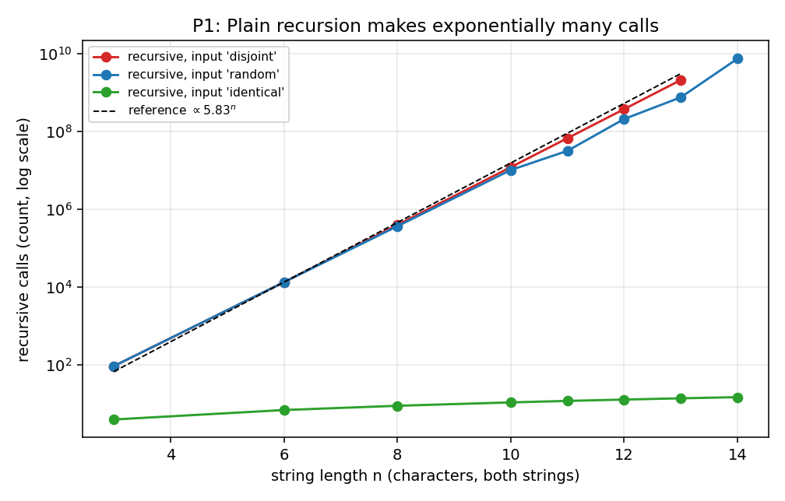
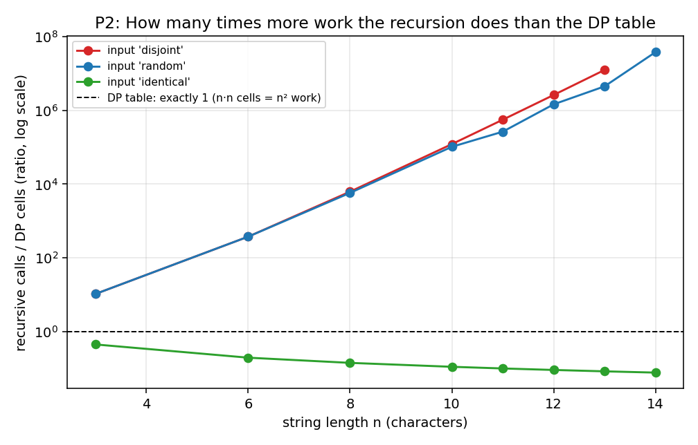
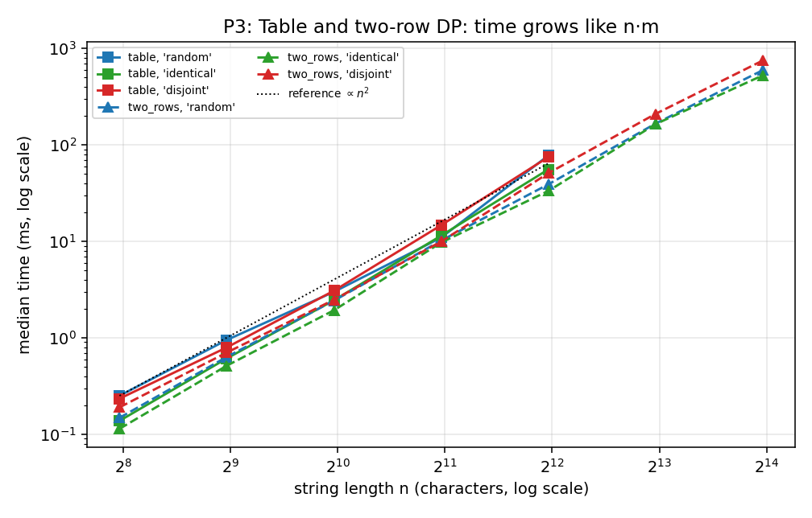
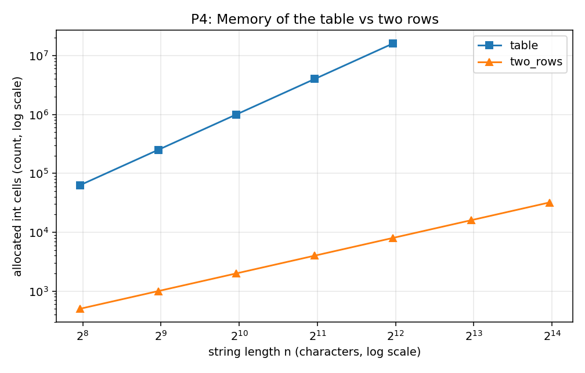
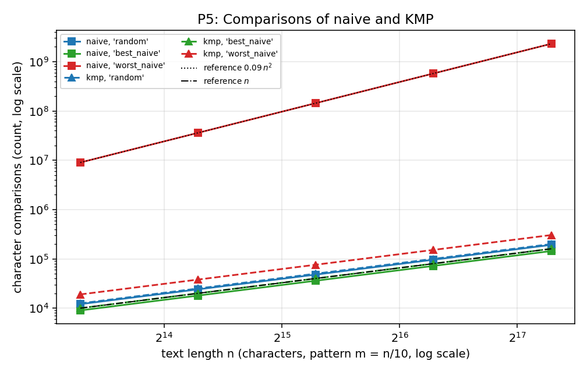
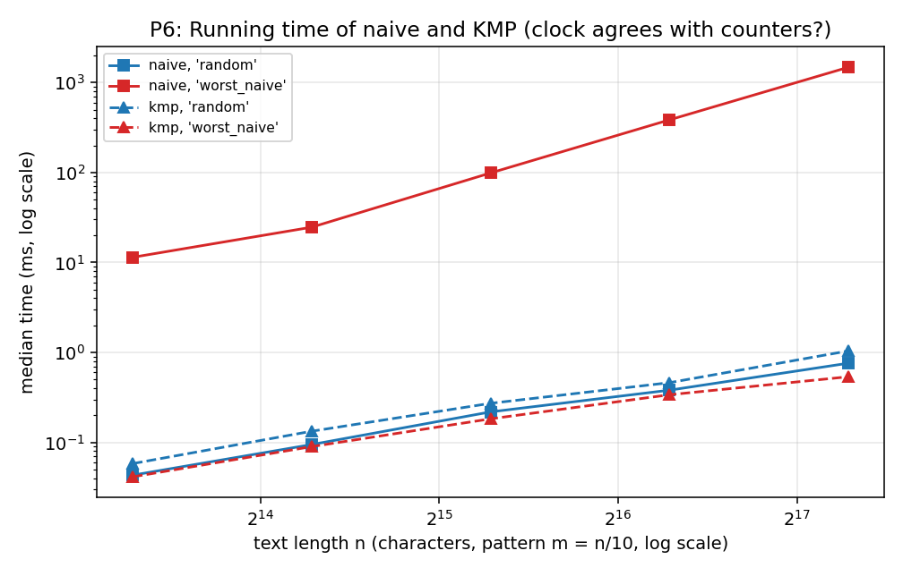

# Assignment 4 – City Search & Spell-Check: DP and String Algorithms

Author: name surname, group XX  
Course: Design and Analysis of Algorithms

## 1. Experiment Design Card

> Written **before the first run** (see git history: the commit `docs(report): add experiment design card`
> comes before `feat(experiment)`). Changes made later are listed in the section "Changes to the card".

| Card field | Content |
|---|---|
| **Question – Edit Distance** | (1) Does the plain recursion really explode exponentially, and at which `n` does it become unusable? (2) Do table and two-row versions grow like `n·m` and does the input change their cost? (3) What does the two-row version save in memory and does it cost time? |
| **Question – String search** | (1) Does the naive search really become quadratic on its worst input while KMP stays linear? (2) Is KMP ever worse than naive on "normal" (random) text? |
| **Sizes (n) – Edit Distance** | Recursive: n = 3, 6, 8, 10, 11, 12, 13, 14 (stop when one run is longer than ~8 s). The largest is more than 4× the smallest; exponential growth means that larger n is not possible, 14 chars is already about 10⁹–10¹⁰ calls for bad input. Table: n = 250, 500, 1000, 2000, 4000 (a 4000×4000 int table is 64 MB, still fine). Two rows: the same sizes plus 8000 and 16000, where the table would need 256 MB / 1 GB. Both strings have length n. |
| **Sizes (n) – Search** | Text length n = 10 000, 20 000, 40 000, 80 000, 160 000 (16×). Pattern length m = n/10, so that the naive worst case `(n−m+1)·m ≈ 0.09·n²` is clearly visible, but the biggest run is still only ~2·10⁹ comparisons (a few seconds). |
| **Inputs – Edit Distance** | `random`: both strings random over 26 letters (typical case, e.g. two typed street names). `identical`: a = b (best case for the recursion, which then makes only n+1 calls; shows that the DP does not "notice" it). `disjoint`: a uses only letters a–m, b only n–z, so no character ever matches – the worst case for the recursion (all three branches are taken in every call) and the case with the most "replace" decisions for the DP. |
| **Inputs – Search** | `random`: random text and random pattern over alphabet {A,C,G,T} (typical log file; the pattern almost never matches for long). `best_naive`: text = A…A, pattern starts with a letter that is not in the text (naive does exactly 1 comparison per start). `worst_naive`: text = A…A, pattern = A…AB (naive compares m chars at every start and fails at the last one; KMP's lps = 0,1,2,… so it has to fall back many times – tests the "≤ 2n" claim). Generator: own `Gen` class, `java.util.Random` with fixed seed `2026 + 31·n + type-id`. |
| **Metrics** | *Edit Distance:* `work` = number of recursive calls (recursive) or number of DP cells computed (table / two rows) – this is the cost the theory talks about; `mem_cells` = number of int cells allocated (memory); `time_ms` (5 runs per point, 3 for the recursion; median is used in the plots). *Search:* `comparisons` = text-char vs pattern-char comparisons in the search phase (the cost in the lecture); `lps_comparisons` = comparisons spent building the LPS array (to see that preprocessing is small); `matches`; `time_ms` (5 runs, median). All counters are increased inside the algorithms. |
| **Prediction** | **Recursion:** calls on `disjoint`/`random` grow by a factor ≈ 5.8 for every +1 of n (Delannoy numbers), so a straight line on a log-y plot; on `identical` calls = n+1 (linear). Practical limit n ≈ 12–13 for 8 s. **Table / two-row:** `work` = n² exactly, for every input type; time ×4 when n ×2 (slope 2 in log-log), identical for all input types up to small noise; two rows a bit faster or equal (less memory traffic), and `mem_cells` n² vs 2n. **Naive:** `random` ≈ 1.3·n comparisons (alphabet 4), `best_naive` ≈ n−m+1, `worst_naive` ≈ 0.09·n² (slope 2). **KMP:** between n and 2n comparisons on every input (slope 1), `lps_comparisons` ≤ 2m. Time: I expect KMP to win only on `worst_naive`; on `random` the naive search can be as fast or even faster because KMP does extra work (LPS array, indirection). |
| **Plots** | P1 *Recursion explosion:* calls vs n (log y), 3 input types – is it exponential? P2 *Ratio calls/cells:* recursive calls divided by n·n (log y) – how much work the memory removes. P3 *DP time:* time vs n (log-log), table vs two rows, 3 inputs – is it quadratic, does the input matter? P4 *Memory:* allocated cells vs n (log-log) – what do two rows save? P5 *Search comparisons:* comparisons vs n (log-log), naive vs KMP, 3 inputs – linear or quadratic? P6 *Search time on worst case:* time vs n (log-log) naive vs KMP, with the random input as reference – does the counter agree with the clock? |

### Changes to the card
* Sizes and inputs are exactly as planned. One rule was made precise in the code: a recursion run is not repeated and the next size is skipped when one run takes more than 8 s. Because of it `disjoint` stops at n = 13, while `random` (whose n = 13 took only 2.4 s) went to n = 14 and `identical` (linear) went to 14 too.
* No other changes.

All numbers below come from `results/results.csv` (one row per run; 5 runs per point, 3 for the recursion). Plots show the **median** time. Counters are exact and the same in every run.

## 2. Plots and Results

  
**P1.** On `disjoint` the number of calls grows by a factor of ≈ 5.6 for every extra character (a straight line on the log axis), while on `identical` it is only n+1.

  
**P2.** At n = 13 the recursion makes about 1.2·10⁷ times more calls than the DP table has cells (2.1·10⁹ calls against 169 cells), and the gap keeps growing.

  
**P3.** Table and two-row time follow the n² reference line, the three input types are almost on top of each other, and the two-row version is equal or faster (and is the only one that reaches n = 16 000).

  
**P4.** The table needs n² cells (16 million at n = 4000), the two rows only 2n (8 002 cells): the lines diverge by a factor of n/2.

  
**P5.** Naive on `worst_naive` lies on the 0.09·n² line (2.1·10⁹ comparisons at n = 160 000), every other curve, including KMP on every input, stays within n … 1.9·n.

  
**P6.** On `worst_naive` naive needs 1560 ms and KMP 0.6 ms at n = 160 000, but on `random` input the two are close and naive is even slightly faster (1.03 ms vs 1.25 ms).

Key numbers (median time in ms, counter in brackets):

| Experiment | n | Result |
|---|---|---|
| Recursive, `disjoint` | 12 / 13 | 1 456 ms (3.8·10⁸ calls) / 6 960 ms (2.1·10⁹ calls) |
| Recursive, `random` | 13 / 14 | 2 353 ms (7.6·10⁸ calls) / 24 557 ms (7.5·10⁹ calls, 1 run) |
| Table, `random` | 4 000 | 81.7 ms (16·10⁶ cells, 16 008 001 allocated ints) |
| Two rows, `random` | 4 000 / 16 000 | 52.4 ms / 691.7 ms (2.56·10⁸ cells, 32 002 allocated ints) |
| Naive, `worst_naive` | 160 000 (m = 16 000) | 1 560 ms (2.07·10⁹ comparisons) |
| KMP, `worst_naive` | 160 000 (m = 16 000) | 0.6 ms (3.04·10⁵ comparisons, 1.9·n; LPS 3.2·10⁴) |
| Naive / KMP, `random` | 160 000 | 1.03 ms (1.2·n) / 1.25 ms (1.25·n) |

## 3. Prediction vs Result

**Edit Distance.**
*Expected:* exponential recursion with a factor ≈ 5.8 per character, linear on `identical`; `work = n²` for table and two rows on every input; time ×4 per doubling; memory n² vs 2n.
*Saw:* all of it, with two small differences. (1) The factor on `disjoint` is 5.56–5.60 (n = 10…13), a bit under 5.83, because the asymptotic factor of the Delannoy numbers is reached only slowly. On `random` the factor jumps (3.1, 6.6, 3.6, 9.8) because every n has different random strings, and the number of equal characters (which the recursion shortcuts) changes from instance to instance, so `random` is not a clean curve. (2) The time did not grow by exactly ×4: the table needs ×6.9 from n = 2000 to 4000 (11.8 → 81.7 ms), two rows ×5.4; from 4000 to 8000 to 16000 the two-row time grows ×3.6 and ×3.65. My explanation (not measured separately): at n = 4000 the table is 64 MB, far bigger than the CPU cache, and has to be allocated and filled for the first time, while two rows (32 KB) stay in the cache. The `work` counter is exactly n² everywhere, so the extra time is not extra work. The input type changes the DP times by at most about ±30 % at the same n (e.g. table, n = 2000: 11.5 / 11.8 / 16.4 ms), while the counters are identical, so I treat it as noise and branch-prediction effects, not as an algorithmic difference.

**String search.**
*Expected:* naive quadratic on `worst_naive`, ≈ n on the other inputs; KMP between n and 2n; naive could be as fast as KMP on random text.
*Saw:* naive `worst_naive` = (n−m+1)·m comparisons exactly (slope 2: m−1 equal characters plus one failing comparison at each start); `random` 1.2·n (my prediction 1.33·n was per start position; times the 0.9·n start positions it gives 1.2·n, so it matches), `best_naive` 0.9·n. KMP: 1.0·n (`best_naive`), 1.25·n (`random`), 1.9·n (`worst_naive`), always below 2n, as proved; LPS building costs at most 2m comparisons (31 997 for m = 16 000). The surprise is in the clock, not in the counters: KMP is the *fastest* on `worst_naive` (0.6 ms) although it makes the *most* comparisons there (1.9·n). Probably the all-"A" text makes every branch predictable, while on random DNA text the branch `t[i] == p[j]` is unpredictable (this I did not measure, it is only a guess). Also the naive time on `worst_naive` for n = 10 000 – 20 000 grows slower than n² (13 → 50 ms, ×3.8, then ×2.0 to 101 ms) because the first runs are still partly interpreted/compiled by the JIT; from 40 000 on the growth is ×3.8 and ×4.1, as expected.

## 4. Short Answers

**Which input made your string search slowest, and why?**
For the naive search it was `worst_naive` (text A…A, pattern A…AC): 1 560 ms at n = 160 000 against 1.03 ms on `random`. At every one of the n−m+1 start positions naive compares all m−1 equal characters and fails only on the last one, then forgets everything and starts again one position to the right, so it makes (n−m+1)·m ≈ 0.09·n² comparisons (2.07·10⁹). The counter and the clock agree for naive. For KMP the input with the most comparisons is the same one (1.9·n), but it is not the slowest in time (see above), which is why I trust the counter for the "worst case" and the clock only for the constant factor.

**How large an n could the recursive Edit Distance handle, and what stopped it?**
On strings without equal characters (`disjoint`) n = 13 (7.0 s median, 2.1·10⁹ calls); on `random` strings n = 14 once (24.6 s, 7.5·10⁹ calls). I stopped at 8 s per run. Time stopped it, not memory: the recursion depth is only n+m ≤ 28 frames. Since every extra character multiplies the work by ≈ 5.6, n = 15 would take about 2–2.5 minutes and n = 20 many days, while the table version needs 0.3 ms for n = 250. On the `identical` input the same code handles any n (n+1 calls), which shows that the recursion is only "slow on purpose" when characters differ.

**What do you gain and what do you lose with two rows instead of the full table?**
Gain: memory goes from (n+1)(m+1) to 2(m+1) ints (16 008 001 → 8 002 at n = 4000; at n = 16 000 the table would need 256·10⁶ ints = 1 GB, two rows need 32 002 ints, and it ran in 0.7 s) and it was also faster in my runs (52 vs 82 ms at n = 4000), because it stays in the cache. The time complexity does not change (`work` = n·m in both). Loss: the whole table is gone, so we get the *number* of edits but cannot walk back through the table to print *which* insertions, deletions and replacements to do (a "did you mean…" display with highlighted changes needs it, or an extra method such as Hirschberg's algorithm), and the code is a little harder to read (swap of rows, swap of the strings).

**If you had to choose one string search for your city platform, which and why?**
KMP. On random-looking text the two methods are practically equal (1.25 ms vs 1.03 ms at 160 000 characters, the naive one is about 20 % faster), but only KMP has a guarantee: never more than 2n comparisons and no text char read backwards, even for repetitive logs such as many identical "ERROR ERROR …" lines, where naive was 2 600 times slower in time and about 6 800 times higher in comparisons. The price is the LPS array of m ints, computed in ≤ 2m comparisons, which is small. For short street names, where n and m are tiny, the choice does not matter for speed, so the worst-case guarantee decides.

## 5. One Paragraph on Time

My measured times range from 0.03 ms (KMP, n = 10 000) to 24.6 s (recursion, n = 14). They are real, but I do not use them as my only evidence: they depend on the computer, JIT warm-up, the cache and the garbage collector (the 7× jump of the table between n = 2000 and 4000 and the slow first naive runs are examples), and for fast runs below ~1 ms a single reading is mostly noise. The medians of 5 runs reduce the noise but do not remove the systematic effects. The counters (calls, cells, comparisons) are exact, identical in every run, and they match the theory (n², Delannoy growth, (n−m+1)·m, ≤ 2n), so the conclusions about *growth* rest on the counters and the time is used to check that the clock tells a similar story and to compare constant factors, where the two sometimes disagree (KMP on `worst_naive`).

## 6. Reproduce

See `README.md`. `results/results.csv` is produced by `daa.exp.Experiment` (fixed seed 2026); the counters are the same on every run, the times will differ a little.
